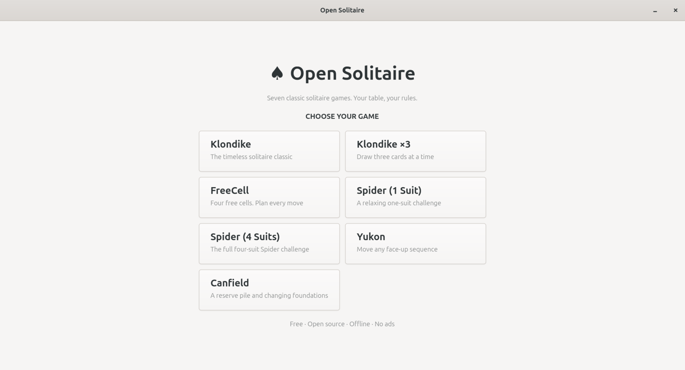
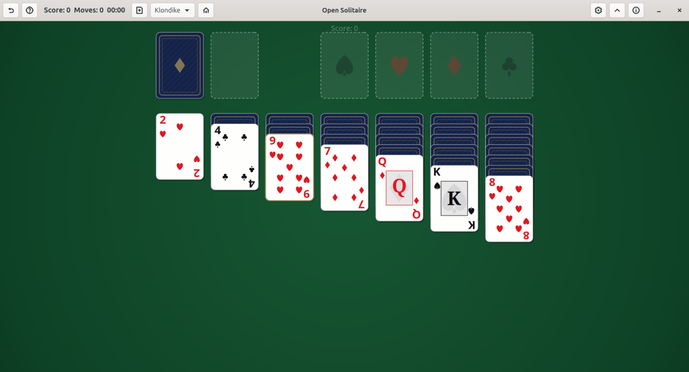

# ♠ Open Solitaire

**Open Solitaire** is a beautiful, fully offline solitaire game for Linux, built with Rust and GTK 4.


## Features

## HEAD
-  **Multiple game modes** — Klondike (draw 1 & 3), FreeCell, Spider (WIP)
-  **Native GTK4** — real Linux app, not a webview. Adwaita header bar, Wayland-first
-  **Cairo-rendered cards** — vector suit shapes, real pip layouts, smooth shadows
-  **Offline forever** — zero network code, no telemetry, no backdoors
-  **Deterministic deals** — every game has a shareable seed number
-  **Keyboard & mouse** — `U` undo, `N` new, `D` draw, `F` auto-foundation
=======
- **7 Classic Game Variants** — Klondike, Klondike Draw 3, FreeCell, Spider (1 Suit), Spider (4 Suits), Yukon, Canfield
- **100% Offline** — No internet connection, no data collection, no ads
- **Smooth Drag & Drop** — Natural card interaction with animations
- **Hint System** — Built-in solver provides guaranteed-winning hints when available
- **Undo** — Unlimited undo up to 500 moves back
- **Multiple Themes** — Deep Emerald, Midnight Blue, Crimson (changeable in Settings)
- **Keyboard Shortcuts** — Full keyboard control for power users
- **Score Tracking** — Live score, move count, and game timer
- **Privacy First** — Zero telemetry, zero analytics, zero data leaving your machine
>>>>>>> 6e347a0 (Release v1.0.0: add seven solitaire games and improved GUI)

## Game Variants

| Game | Difficulty | Description |
|------|-----------|-------------|
| Klondike | ⭐⭐ | The classic. Build 4 foundations Ace→King by suit. |
| Klondike (Draw 3) | ⭐⭐⭐ | Klondike but draw 3 cards at once. |
| FreeCell | ⭐⭐⭐ | All cards face-up, 4 free cells. Almost always solvable. |
| Spider (1 Suit) | ⭐⭐⭐ | 2 decks, all Spades. Build 8 K→A sequences. |
| Spider (4 Suits) | ⭐⭐⭐⭐⭐ | 2 decks, all suits. The ultimate challenge. |
| Yukon | ⭐⭐⭐ | All cards face-up. Move any face-up group. |
| Canfield | ⭐⭐⭐⭐ | Fast-paced with a reserve pile. Draw 3. |

## Keyboard Shortcuts

| Key | Action |
|-----|--------|
| `U` | Undo last move |
| `H` | Hint (applies next winning move) |
| `F` | Auto-foundation all cards |
| `D` | Draw from stock |

## Installation

### Prerequisites

- Rust (stable) — [rustup.rs](https://rustup.rs)
- GTK 4 development libraries
- libadwaita development libraries

**On Ubuntu/Debian:**
```bash
sudo apt install libgtk-4-dev libadwaita-1-dev
```

**On Fedora/RHEL:**
```bash
sudo dnf install gtk4-devel libadwaita-devel
```

**On Arch Linux:**
```bash
sudo pacman -S gtk4 libadwaita
```

### Quick Install

```bash
git clone https://github.com/abdelkader/openpatience
cd openpatience
./install.sh          # installs to /usr/local by default
```

Or with a custom prefix:
```bash
PREFIX=~/.local ./install.sh
```

### Manual Build

```bash
cargo build --release
./target/release/openpatience
```

## Uninstall

```bash
./uninstall.sh
```

## Privacy Policy

Open Solitaire collects **absolutely no data**. It has no network access, no telemetry, no analytics, and no crash reporting. Your game data exists only in RAM while the app is running and is discarded when you close it. See the Privacy tab in the About dialog for full details.

## Developer

**Abdelkader Berassil**  
Computer Science Engineer · Algeria  
GitHub: [@dynaio](https://github.com/dynaio)

## License

GNU General Public License v3.0 or later — see [LICENSE](LICENSE) for details.

This is free software: you can use, copy, modify and distribute it under the terms of the GPL-3.0+.

## Screenshots

### Home Screen



### Gameplay



